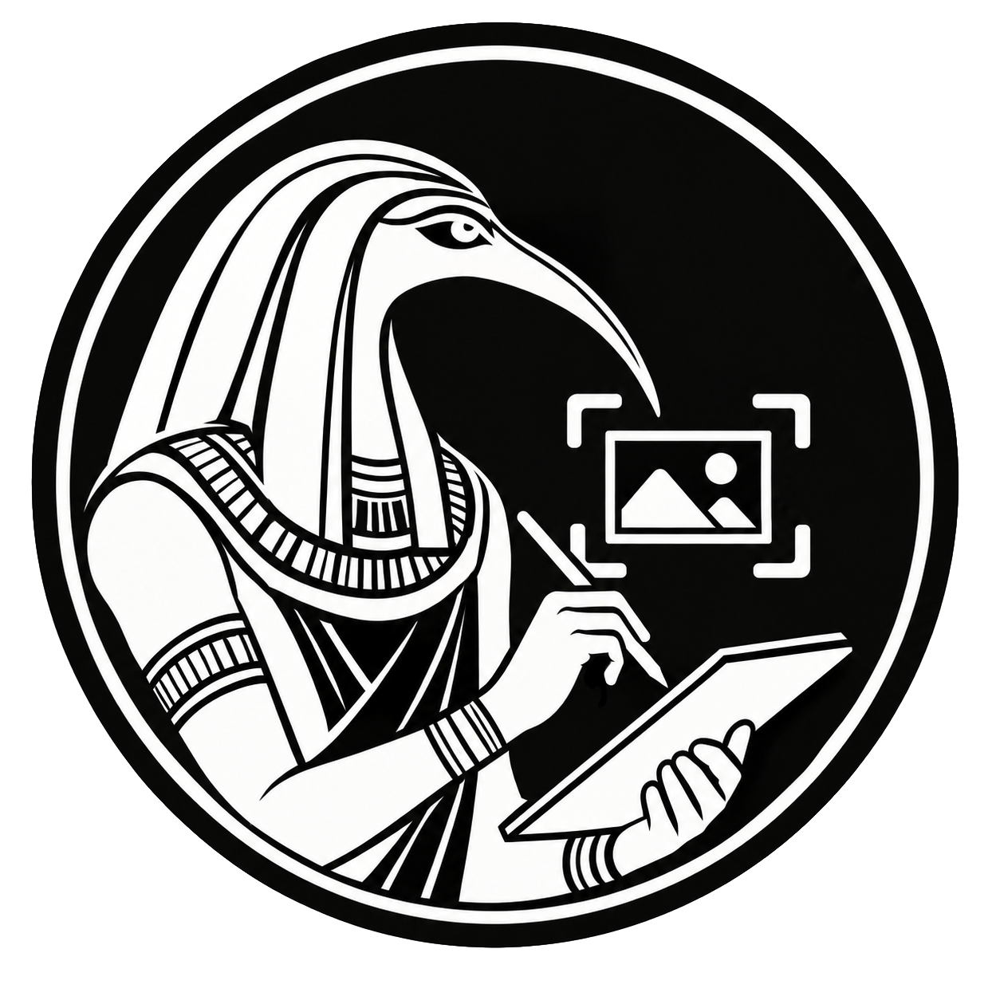
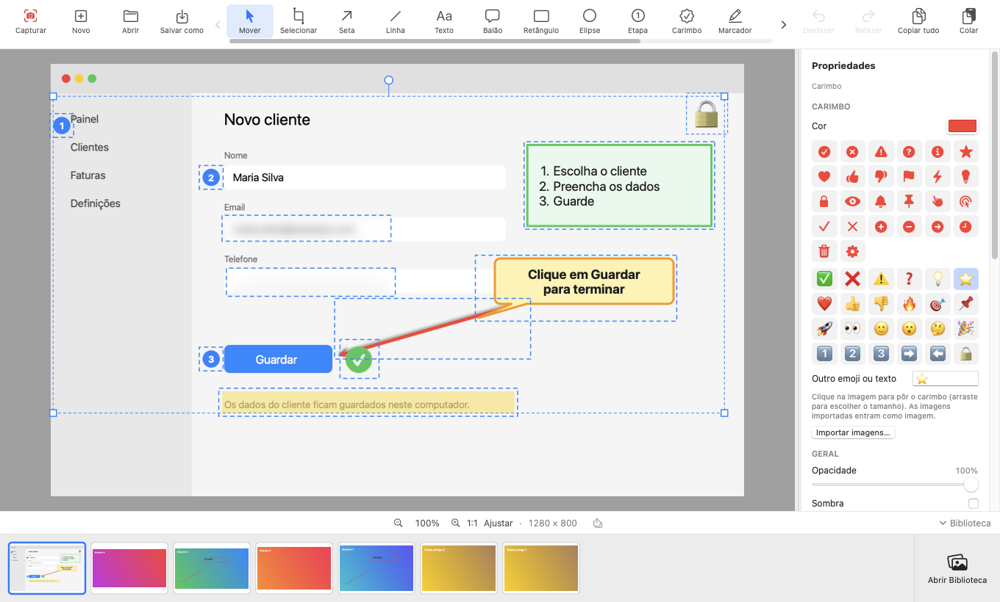
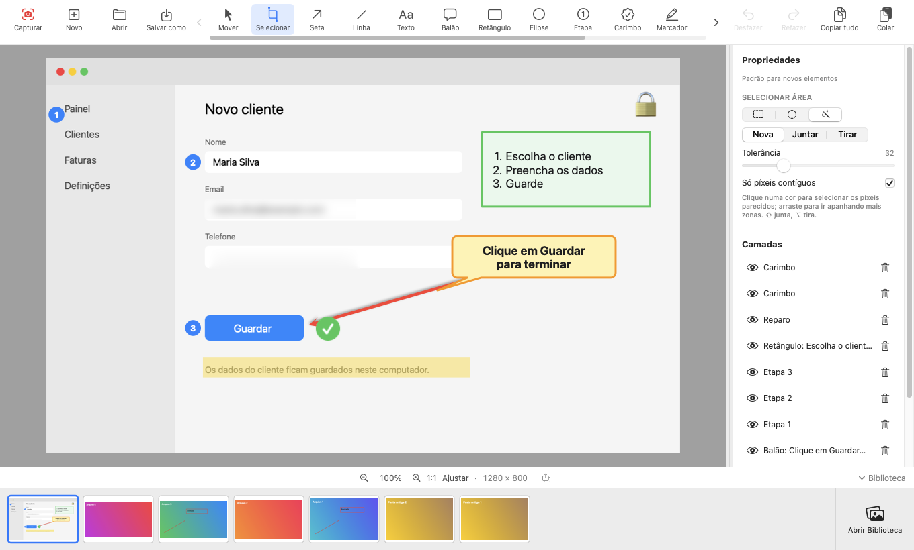
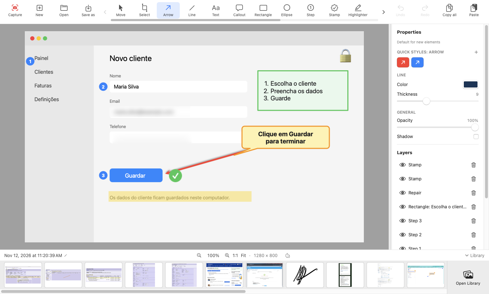

# T O T H

### Captura. Anota. Grava. Edita.
*Capture. Annotate. Record. Edit.*

**Uma só app, no seu Mac. Sem conta, sem nuvem, sem telemetria.** 
*One app, on your Mac. No account, no cloud, no telemetry.*

 

[Português](#português) &nbsp;·&nbsp; [English](#english) &nbsp;·&nbsp; [Guia completo · Full guide](docs/GUIA.md)

 

 

## 🧩 Uma app em vez de quatro &nbsp;·&nbsp; *One app instead of four*

| | Normalmente precisa de… · *Usually takes…* | **Toth** |
|---|---|:---:|
| 📸 **Capturar** · *Capture* | uma app de capturas (região, janela, página por rolagem) | ✅ |
| ✏️ **Anotar** · *Annotate* | um editor de anotações (setas, texto, etapas, pixelização, reparo) | ✅ |
| 🎥 **Gravar** · *Record* | um gravador de ecrã (área ou janela, áudio do sistema, microfone) | ✅ |
| ✂️ **Editar vídeo** · *Edit video* | um editor de vídeo (cortes, anotações com tempo, música, narração, GIF) | ✅ |
| 🔒 **Privacidade** · *Privacy* | confiar que nada sai do computador | **100 % local** |
| 💶 **Preço** · *Price* | três ou quatro licenças | **Gratuito · MIT** |

<table>
<tr>
<td width="25%" valign="top"><h4>📸 Capturar</h4>Região com o ecrã <b>congelado</b>, <b>janela</b> (com ou sem sombra, mesmo tapada), <b>página inteira por rolagem</b> e ecrã completo. Atalho global.</td>
<td width="25%" valign="top"><h4>✏️ Anotar</h4>Setas, texto, balões, etapas, carimbos, pixelização, desfoque e <b>reparo</b>. <b>Selecionar área</b> (varinha), alinhar, agrupar, rodar. <b>Sempre reeditável</b>.</td>
<td width="25%" valign="top"><h4>🎥 Gravar</h4>Área ou janela em MP4, com <b>áudio do sistema</b> e <b>microfone à escolha</b>, cada um na sua faixa. Pausar e retomar.</td>
<td width="25%" valign="top"><h4>✂️ Editar vídeo</h4>Cortes ao quadro, <b>anotações com início e fim</b>, música, narração, velocidade. Guarda em <b>MP4, GIF ou só áudio</b>.</td>
</tr>
</table>

---

## Português

O **Toth** é uma app nativa para Mac, escrita em Swift puro, que junta num só sítio o que costuma pedir várias apps: **capturar, anotar, gravar e editar vídeo**. Corre inteiramente no seu computador: sem conta, sem nuvem, sem telemetria, sem anúncios. É **software livre** (licença MIT) e o código está aqui.

### O que só o Toth junta

- **Captura → anotação → vídeo, sem mudar de app.** A mesma barra de ferramentas serve para anotar uma imagem e para anotar um vídeo. Uma seta desenhada sobre um fotograma tem **início e fim** e pode **seguir** o que se move.
- **Nada é destrutivo.** Pixelização, desfoque, reparo, recortes, cortes de vídeo: tudo são camadas que pode mudar ou tirar amanhã. A imagem e o vídeo originais nunca são alterados. Tudo fica num ficheiro `.capture` que reabre como deixou.
- **Texto da imagem, para copiar e editar.** Reconhece o texto de qualquer captura (no Mac, sem rede), copia-o com ⌘C e, com um duplo clique, **torna-o editável no mesmo estilo**: tamanho, cor, negrito e a fonte mais parecida, com o original apagado por baixo.
- **Reparo e seleção a sério numa app de capturas.** **Preencher** apaga um elemento a partir do que o rodeia; **Clonar** cobre-o com outra zona. A **varinha** seleciona por cor (arraste para apanhar mais), e a área levanta-se, duplica-se, apaga-se ou preenche-se.
- **A tela segue o conteúdo.** Arraste uma seta para fora da imagem e a área de trabalho cresce; volte com ela e encolhe. Mova, rode e redimensione a própria captura sem a estragar.
- **Nitidez de píxel.** Captura e gravação à resolução nativa do ecrã, zoom 1:1 em píxeis do ecrã, H.264 com débito alto. O que vê é o que fica.
- **Privacidade verificável.** O único pedido de rede é a procura de atualizações (desligável), as versões são verificadas por SHA-256 e assinatura, e o código é aberto.

### Novidades da versão 0.6.0

| | |
|---|---|
| **Texto da imagem** | Ferramenta nova: reconhece o texto da captura (Vision, local; PT e EN) e marca cada linha. Clique e **⌘C** copia; **duplo clique** torna a linha editável: um Reparo apaga o original e uma caixa de Texto fica no mesmo sítio com as mesmas palavras, **tamanho, cor, negrito** e a fonte mais parecida. |
| **Ferramenta Selecionar** | **Retângulo, elipse ou varinha** (por cor, com tolerância e «só contíguos»). Com a varinha, **arraste** para ir apanhando mais zonas. Modos **Nova / Juntar / Tirar** (⇧ junta e ⌥ tira em qualquer modo), ⌘A tudo, Esc limpa. |
| **O que se faz com a área** | **Arraste de dentro** para a levantar como objeto e movê-la logo (o sítio fica apagado); **Return** levanta sem mover; **⌘D** duplica; **⌘C** copia os píxeis com transparência; **Delete** apaga (cor de fundo ou transparente); **Preencher (Reparo)** apaga a partir do que a rodeia. O objeto levantado tem a forma da seleção. |
| **Tela ajusta-se sempre ao conteúdo** | A área de trabalho cresce quando um elemento sai e **encolhe** quando volta, se esconde ou é apagado. Mudar a área à mão desliga o ajuste; liga-se de novo no painel. |
| **Nitidez** | Zoom em píxeis do ecrã (1:1 = um píxel da imagem por píxel do ecrã; «Ajustar» nunca amplia além disso), captura e gravação com resolução máxima, H.264 com mais débito. |
| **Pequenos cuidados** | Imagem colada ao tamanho real, com redimensionar em proporção; carimbos «distintivo» com o desenho branco sobre a cor; sem linhas ténues nas bordas do desfoque e do reparo. |
| **Interface** | As ferramentas deslizam sozinhas com o rato pousado junto a uma ponta da barra (e com a roda/trackpad em toda a altura). A faixa de baixo mostra as **20 capturas mais recentes**; clicar numa e premir **Backspace** envia-a para o Lixo. |

<b>Versões anteriores</b> (0.5.0 · 0.4.0 · 0.3.0)

#### 0.5.0 — Captura de janela, carimbos, Reparo e vídeo com anotações

| | |
|---|---|
| **Captura de janela** | No seletor, **Espaço** (ou o ícone de janela) e clique numa janela: fica só ela, mesmo tapada, **com ou sem sombra**. Também grava uma janela em vídeo. |
| **Carimbos** | Símbolos pintados com a cor escolhida, **emojis** ou texto curto, e **imagens importadas** (PNG, JPEG, SVG…) numa biblioteca sua. |
| **Reparo** | **Preencher** (a partir do que rodeia) ou **Clonar** (alça verde escolhe a origem). Não destrutivo, como o Blur. |
| **Disposição** | **Alinhar** e **distribuir**; **agrupar** (⌘G); redimensionar e rodar o grupo inteiro. |
| **Arrastar para fora** | Pega no rodapé para arrastar o PNG final para outra app; **Copiar tudo** leva também um ficheiro. |
| **Vídeo: anotações com início e fim** | Botão **Anotar**: todas as ferramentas do editor de imagem sobre o fotograma; cada anotação tem início e fim e pode **seguir** uma zona. Vão para a reprodução e para o MP4. |
| **Vídeo: áudio** | **Volume e fade** por linha, **importar música**, **gravar narração** com o **microfone à escolha**. |
| **Vídeo: velocidade e saída** | 0,25× a 4× por clipe sem mudar o tom; **miniaturas** opcionais; guardar em **MP4**, **GIF** ou **só áudio** (M4A). |

#### 0.4.0 — Rodar e enquadrar

| | |
|---|---|
| **Rodar qualquer elemento** | Alça redonda (encosta aos 15°; ⌥ liberta) ou graus no painel. Alças, toque e edição de texto acompanham. |
| **Tela → Imagem** | A própria captura move-se, redimensiona-se e roda-se, sem alterar o original; «Restaurar original» volta atrás. |
| **Texto** | Caixas que **ajustam a altura ao texto**; redimensionar em proporção; letra até 400. |

#### 0.3.0 — Gravação e editor de vídeo

| | |
|---|---|
| **Gravação** | Área do ecrã em **MP4** (H.264 + AAC): gravar, pausar, retomar, parar. **Áudio do sistema** e **microfone** em faixas separadas. |
| **Linha de tempo de três linhas** | Blocos inteiros que se arrastam; ponto exato ao quadro; cortar e juntar ou deixar espaço; copiar e colar; inverter; quebra; olho e cadeado por linha; zoom. |
| **Sem riscos** | Edição não destrutiva, desfazer e refazer, a edição volta ao reabrir. |

### O essencial
- **Captura** de região (com o ecrã congelado), de **janela** (com ou sem sombra), de **página inteira por rolagem** e do ecrã completo; atalho global configurável (**⌃⇧4**).
- **Anotação não destrutiva**: setas, linhas, texto, balões, formas, etapas numeradas, carimbos, marcador, pixelização, desfoque e reparo; **selecionar área**, **rodar**, **alinhar** e **agrupar**; camadas, copiar e colar, desfazer e refazer. Tudo num ficheiro `.capture` reeditável.
- **Tela** que se ajusta ao conteúdo, e **mover, redimensionar e rodar a própria captura** sem alterar a imagem original.
- **Gravação** de área ou janela com áudio do sistema e microfone; **editor de vídeo** com cortes, anotações com tempo, música, narração, velocidade; MP4, GIF ou áudio.
- **Biblioteca** de capturas e vídeos, e abertura de qualquer imagem do computador.
- **Português e inglês**, **atualizações verificadas** (SHA-256), e **privacidade total**: a única ligação à internet é a procura de versões novas, desligável.

Veja o [guia completo](docs/GUIA.md) para cada funcionalidade em detalhe.

### Uma alternativa livre e local a
O Toth pode substituir, em parte, estas apps para quem só precisa do essencial: capturar, anotar, gravar e fazer cortes simples. É gratuito, sem conta, sem nuvem e sem telemetria.

| Tarefa | Apps habituais | O que o Toth cobre |
|---|---|---|
| Captura e anotação | Shottr, CleanShot X, Skitch, Snagit, Monosnap, Lightshot | Captura de região e de janela, anotações (setas, texto, etapas, carimbos, pixelização, desfoque, reparo, seleção por varinha, texto reconhecido e editável) e edição que pode reabrir |
| Captura com rolagem | CleanShot X, Snagit, Shottr | Página inteira por rolagem |
| Gravação de ecrã | QuickTime Player, Kap, Loom, ScreenFlow, Camtasia | Gravação de uma área ou de uma janela, com áudio do sistema e microfone; GIF |
| Edição de vídeo simples | iMovie, ScreenFlow, Camtasia | Cortes, cópia, inversão, quebra, velocidade, anotações com tempo, música e narração: um editor básico, não uma suíte completa |

O Toth não tem legendas automáticas, efeitos nem transições, e não partilha online (por decisão de projeto), por isso não substitui por inteiro as apps mais completas.

*Todas as marcas pertencem aos respetivos donos. Os nomes servem só para indicar a que o Toth pode servir de alternativa; o Toth não é afiliado nem recomendado por essas empresas.*

### Instalação
**Requisitos:** macOS 15 ou superior (Apple Silicon e Intel; testado em Apple Silicon).

1. Em [**Releases**](../../releases/latest), descarregue `Toth-0.6.0.zip` e descomprima.
2. Arraste `Toth.app` para **Aplicações**.
3. **Primeira abertura (uma só vez).** A app ainda não está notarizada pela Apple, por isso o macOS mostra *“Toth” não aberto*. **Não mova para o Lixo:** clique em **OK**, abra **Definições do Sistema → Privacidade e Segurança**, desça até **Segurança**, clique em **Abrir mesmo assim** junto a “Toth” e confirme. (No macOS 14 ou anterior: botão direito → **Abrir**. No Terminal: `xattr -dr com.apple.quarantine /Applications/Toth.app`.)
4. **Permissão guiada.** Ao abrir, o Toth verifica a **Gravação de Ecrã** e, se faltar, mostra um guia de 3 passos: **Conceder permissão** → ativar o Toth na lista → **Reiniciar o Toth**.

| Permissão | Precisa? | Para quê |
|---|---|---|
| **Gravação de Ecrã e Áudio do Sistema** | **Sim** | Ler o ecrã para capturar e gravar (e o som do sistema). Só quando o utilizador o pede. |
| **Microfone** | Opcional | Só se ligar o microfone ao gravar vídeo; o macOS pede-a nessa altura. |
| Acessibilidade, câmara, contactos, localização | Não | Não são usadas. O Toth não envia teclas nem rolagens a outras apps. |
| Rede | Só atualizações | Um pedido à API pública do GitHub, sem dados pessoais. Desligável em *Preferências*. |

As capturas, vídeos e carimbos importados ficam em `~/Pictures/TothCapture` (pasta alterável em *Preferências*, com tudo movido para o novo sítio). **Atualizações:** o Toth procura uma versão nova ao abrir (no máximo uma vez por dia), pergunta se quer atualizar, verifica a soma SHA-256 e a assinatura e instala sem tocar nas suas capturas. As versões são assinadas sempre com a mesma identidade, por isso a permissão mantém-se. **Desinstalar:** arraste `Toth.app` para o Lixo.

<table align="center">
<tr><td align="center">
 
<strong>☕ Gostou do Toth?</strong>  
O projeto é gratuito e livre, e vai continuar a sê-lo. 
Se quiser ajudar a mantê-lo, pode apoiar de forma voluntária. 
Nada na app depende disso.  

  
</td></tr>
</table>

### Compilar e contribuir
Só são precisas as *Command Line Tools* do macOS: `./scripts/build-app.sh` gera `dist/Toth.app` e o zip. Guia para programadores em [docs/DEVELOPMENT.md](docs/DEVELOPMENT.md). Contribuições são bem-vindas (*issue* ou *pull request*). Segurança: [SECURITY.md](SECURITY.md).

### Licença
**MIT** (software livre): [LICENSE](LICENSE) ([tradução de cortesia](LICENSE.pt.md)). © 2026 **Alex Felizardo**. O nome e o logótipo não estão abrangidos pela MIT ([TRADEMARKS.md](TRADEMARKS.md)). [Privacidade](PRIVACY.md) · [Segurança](SECURITY.md) · [Avisos de terceiros](THIRD_PARTY_NOTICES.md).

---

## English

**Toth** is a native Mac app, written in pure Swift, that brings together what usually takes several apps: **capture, annotate, record and edit video**. It runs entirely on your computer: no account, no cloud, no telemetry, no ads. It is **free software** (MIT License) and the source is right here.

### What only Toth puts together

- **Capture → annotation → video, without switching apps.** The same toolbar annotates an image and a video. An arrow drawn over a frame has a **start and an end** and can **follow** what moves.
- **Nothing is destructive.** Pixelate, blur, repair, cut-outs, video cuts: they are all layers you can change or remove tomorrow. The original image and video are never altered. Everything lives in a `.capture` file that reopens as you left it.
- **Image text, to copy and edit.** Recognizes the text in any capture (on the Mac, no network), copies it with ⌘C and, with a double-click, **makes it editable in the same style**: size, color, bold and the closest font, with the original erased underneath.
- **Real repair and selection in a screenshot app.** **Fill** removes an element from its surroundings; **Clone** covers it with another part of the image. The **magic wand** selects by color (drag to pick up more), and the area lifts, duplicates, erases or fills.
- **The canvas follows the content.** Drag an arrow out of the image and the work area grows; bring it back and it shrinks. Move, rotate and resize the capture itself without damaging it.
- **Pixel sharpness.** Capture and recording at the screen's native resolution, 1:1 zoom in screen pixels, high-bitrate H.264. What you see is what you keep.
- **Verifiable privacy.** The only network request is the update check (which you can turn off), releases are verified by SHA-256 and signature, and the code is open.

### What's new in 0.6.0

| | |
|---|---|
| **Image text** | New tool: recognizes the text in the capture (Vision, local; PT and EN) and marks each line. Click and **⌘C** copies; **double-click** makes the line editable: a Repair erases the original and a Text box takes its place with the same words, **size, color, bold** and the closest font. |
| **Select tool** | **Rectangle, ellipse or magic wand** (by color, with tolerance and “contiguous only”). With the wand, **drag** to keep picking up more areas. **New / Add / Subtract** modes (⇧ adds and ⌥ subtracts in any mode), ⌘A all, Esc clears. |
| **What you do with the area** | **Drag from inside** to lift it as an object and move it right away (the spot is erased); **Return** lifts without moving; **⌘D** duplicates; **⌘C** copies the pixels with transparency; **Delete** erases (background color or transparent); **Fill (Repair)** erases from the surroundings. The lifted object keeps the shape of the selection. |
| **Canvas always fits the content** | The work area grows when an element goes outside and **shrinks** when it comes back, is hidden or deleted. Changing the area by hand turns the fit off; the panel turns it back on. |
| **Sharpness** | Zoom in screen pixels (1:1 = one image pixel per screen pixel; “Fit” never enlarges beyond that), capture and recording at full resolution, higher-bitrate H.264. |
| **Small touches** | Pasted images at real size, with proportional resize; “badge” stamps with a white glyph over the color; no faint lines at the edges of blur and repair. |
| **Interface** | Tools slide by themselves when the pointer rests near either end of the bar (and with the wheel/trackpad over the whole bar). The bottom strip shows the **20 most recent captures**; click one and press **Backspace** to move it to the Trash. |

<b>Earlier versions</b> (0.5.0 · 0.4.0 · 0.3.0)

#### 0.5.0 — Window capture, stamps, Repair and annotated video

| | |
|---|---|
| **Window capture** | In the selector, **Space** (or the window icon) and click a window: only that window, even if partly covered, **with or without its shadow**. Windows can be recorded as video too. |
| **Stamps** | Symbols painted in your color, **emojis** or short text, and **imported pictures** (PNG, JPEG, SVG…) in a library of your own. |
| **Repair** | **Fill** (from the surroundings) or **Clone** (the green handle picks the source). Non-destructive, like Blur. |
| **Arrange** | **Align** and **distribute**; **group** (⌘G); resize and rotate the whole group. |
| **Drag out** | A grip in the footer drags the final PNG to another app; **Copy all** carries a file too. |
| **Video: annotations with a start and an end** | **Annotate** button: every image-editor tool over the frame; each annotation has a start and an end and can **follow** a region. They go into playback and into the MP4. |
| **Video: audio** | **Volume and fade** per lane, **import music**, **record a narration** with the **microphone of your choice**. |
| **Video: speed and output** | 0.25× to 4× per clip without changing pitch; optional **thumbnails**; save as **MP4**, **GIF** or **audio only** (M4A). |

#### 0.4.0 — Rotate and frame

| | |
|---|---|
| **Rotate any element** | Round handle (snaps to 15°; ⌥ frees it) or degrees in the panel. Handles, hit-testing and text editing follow. |
| **Canvas → Image** | The capture itself moves, resizes and rotates without altering the original; “Restore original” goes back. |
| **Text** | Boxes that **fit their height to the text**; proportional resize; font size up to 400. |

#### 0.3.0 — Recording and video editor

| | |
|---|---|
| **Recording** | A screen area to **MP4** (H.264 + AAC): record, pause, resume, stop. **System audio** and **microphone** on separate tracks. |
| **Three-lane timeline** | Whole blocks you drag; exact frame; cut and join or leave a gap; copy and paste; reverse; break; eye and lock per lane; zoom. |
| **Safe** | Non-destructive editing, undo and redo, the edit returns when you reopen. |

### The essentials
- **Capture** a region (with a frozen screen), a **window** (with or without shadow), a **whole page by scrolling**, or the full screen; configurable global shortcut (**⌃⇧4**).
- **Non-destructive annotation**: arrows, lines, text, callouts, shapes, numbered steps, stamps, highlighter, pixelate, blur and repair; **select area**, **rotate**, **align** and **group**; layers, copy and paste, undo and redo. Everything lives in a `.capture` file you can edit again.
- A **canvas** that fits the content, and **move, resize and rotate the capture itself** without altering the original image.
- **Recording** of an area or a window with system audio and microphone; a **video editor** with cuts, timed annotations, music, narration, speed; MP4, GIF or audio.
- A **library** of captures and videos, and opening any image on your computer.
- **Portuguese and English**, **verified updates** (SHA-256), and **full privacy**: the only network call is the check for new versions, which can be turned off.

See the [full guide](docs/GUIA.md#english) for every feature in detail.

### A free, local alternative to
Toth can stand in, in part, for these apps if all you need is the essentials: capture, annotate, record and make simple cuts. It is free, with no account, no cloud and no telemetry.

| Task | Usual apps | What Toth covers |
|---|---|---|
| Capture and annotation | Shottr, CleanShot X, Skitch, Snagit, Monosnap, Lightshot | Region and window capture, annotations (arrows, text, steps, stamps, pixelate, blur, repair, wand selection, recognized and editable text) and editing you can reopen |
| Scrolling capture | CleanShot X, Snagit, Shottr | A whole page by scrolling |
| Screen recording | QuickTime Player, Kap, Loom, ScreenFlow, Camtasia | Recording an area or a window, with system audio and microphone; GIF |
| Simple video editing | iMovie, ScreenFlow, Camtasia | Cuts, copy, reverse, break, speed, timed annotations, music and narration: a basic editor, not a full suite |

Toth has no automatic captions, effects or transitions, and does not share online (by design), so it does not fully replace the more complete apps.

*All trademarks belong to their respective owners. The names are used only to say what Toth can be an alternative to; Toth is not affiliated with or endorsed by those companies.*

### Installation
**Requirements:** macOS 15 or later (Apple Silicon and Intel; tested on Apple Silicon).

1. Under [**Releases**](../../releases/latest), download `Toth-0.6.0.zip` and unzip it.
2. Drag `Toth.app` to **Applications**.
3. **First launch (once).** The app is not yet notarized by Apple, so macOS shows *“Toth” Not Opened*. **Don't move it to the Trash:** click **Done**, open **System Settings → Privacy & Security**, scroll to **Security**, click **Open Anyway** next to “Toth” and confirm. (On macOS 14 or earlier: right-click → **Open**. In Terminal: `xattr -dr com.apple.quarantine /Applications/Toth.app`.)
4. **Guided permission.** On launch, Toth checks **Screen Recording** and, if missing, shows a 3-step guide: **Grant permission** → turn Toth on in the list → **Restart Toth**.

| Permission | Needed? | What for |
|---|---|---|
| **Screen & System Audio Recording** | **Yes** | Reading the screen to capture and record (and system sound). Only when you ask. |
| **Microphone** | Optional | Only if you turn the microphone on while recording video; macOS asks then. |
| Accessibility, camera, contacts, location | No | Not used. Toth never sends keys or scrolling to other apps. |
| Network | Updates only | One request to GitHub's public API, no personal data. Can be turned off in *Preferences*. |

Captures, videos and imported stamps are saved in `~/Pictures/TothCapture` (the folder can be changed in *Preferences*, with everything moved to the new place). **Updates:** Toth checks for a new version on launch (at most once a day), asks whether to update, verifies the SHA-256 checksum and signature, and installs without touching your captures. Releases are always signed with the same identity, so the permission is kept. **Uninstall:** drag `Toth.app` to the Trash.

<table align="center">
<tr><td align="center">
 
<strong>☕ Enjoying Toth?</strong>  
The project is free and open, and will stay that way. 
If you would like to help keep it going, you can support it voluntarily. 
Nothing in the app depends on it.  

  
</td></tr>
</table>

### Build and contribute
Only the macOS *Command Line Tools* are needed: `./scripts/build-app.sh` produces `dist/Toth.app` and the zip. Developer guide: [docs/DEVELOPMENT.md](docs/DEVELOPMENT.md). Contributions are welcome (*issue* or *pull request*). Security: [SECURITY.md](SECURITY.md).

### License
**MIT** (free software): [LICENSE](LICENSE). © 2026 **Alex Felizardo**. The name and the logo are not covered by the MIT License ([TRADEMARKS.md](TRADEMARKS.md)). [Privacy](PRIVACY.md) · [Security](SECURITY.md) · [Third-party notices](THIRD_PARTY_NOTICES.md).
