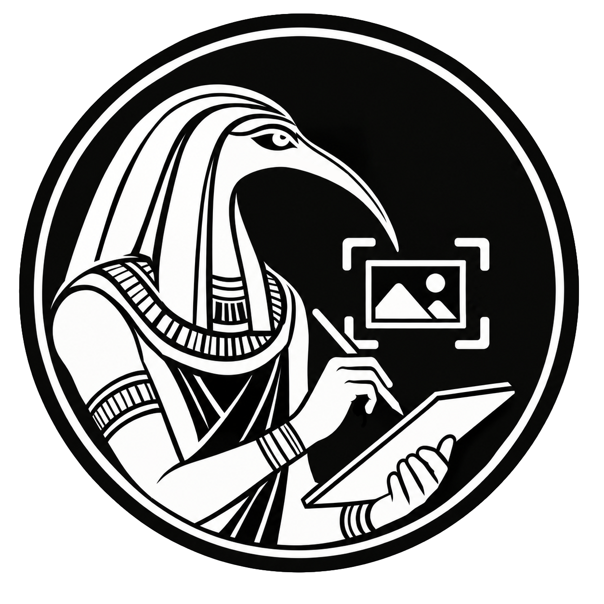
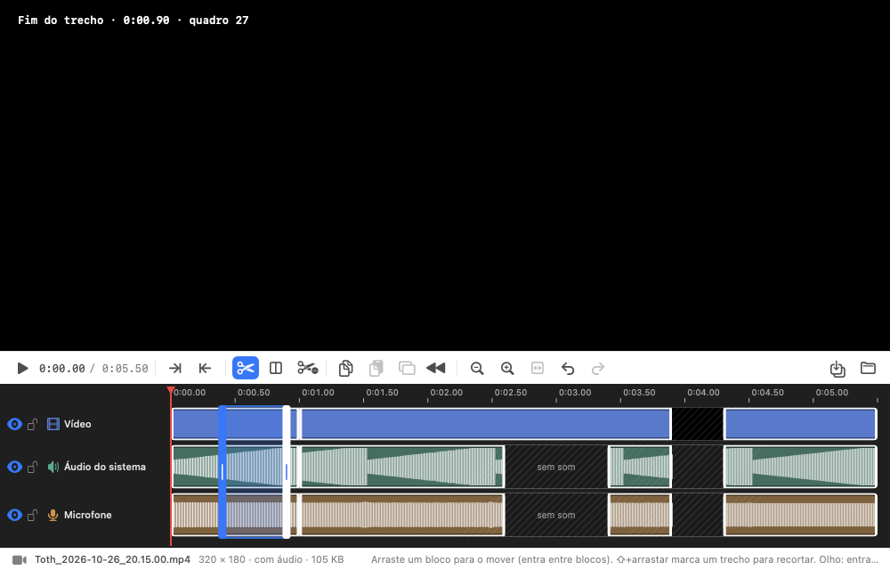

<h1 align="center">Toth</h1>

  <strong>Captura, anota e edita. Tudo no seu Mac, sem nuvem.</strong> 
  <em>Capture, annotate and edit. All on your Mac, no cloud.</em>

  
  
  
  

  <a href="#português">Português</a> · <a href="#english">English</a> · <a href="docs/GUIA.md">Guia completo · Full guide</a> · <a href="../../releases/latest"><strong>Descarregar · Download</strong></a>

---

## Português

O **Toth** é uma app nativa para Mac, escrita em Swift puro, para **capturar e anotar o ecrã** e agora também **gravar e editar vídeo**. Corre inteiramente no seu computador: sem conta, sem nuvem, sem telemetria, sem anúncios. É **software livre** (licença MIT) e o código está aqui.

### Porquê «Toth»
Na mitologia egípcia, **Thoth (Toth)** é o deus da **escrita, do conhecimento e da sabedoria**: o escriba dos deuses, que registava, media e dava forma ao que era dito. Esta app faz, em pequeno, o mesmo gesto: **guarda o que vê e dá-lhe sentido**. Uma captura é um registo; as setas, o texto e os cortes são a forma de o explicar. O nome lembra que um ecrã só se torna conhecimento quando alguém o escreve, o anota e o partilha com clareza.

### Novidades da versão 0.3.0
**Gravação de vídeo**
- Grave uma área do ecrã em **MP4** (H.264 + AAC) com uma barra só de ícones: **gravar, pausar, retomar e parar**.
- **Áudio do sistema** e **microfone** ligam-se e desligam-se a qualquer momento, e cada um fica na sua faixa.

**Editor de vídeo com linha de tempo de três linhas** (vídeo, áudio do sistema, microfone)

| | |
|---|---|
| **Blocos inteiros** | Cada clipe é um bloco: clique para o marcar, arraste para o mover. O bloco entra na junção mais próxima e o resto desloca-se, sem partir nem apagar nada. |
| **Ponto exato** | Ao marcar um trecho, o leitor mostra o fotograma exato da ponta (com o número do quadro); as setas afinam-no quadro a quadro. |
| **Cortar** | Cortar e juntar (o resto toca seguido) ou cortar deixando um espaço, com ou sem vídeo. |
| **Copiar e colar** | Inserindo (o resto avança) ou por cima. |
| **Inverter** | O trecho toca de trás para a frente. |
| **Quebra** | Divide um clipe em dois blocos sem cortar nada (B, ícone ou botão direito). |
| **Por linha** | A marcação e as operações aplicam-se só à linha escolhida. O **olho** suprime a linha no resultado (reprodução e exportação) e o **cadeado** protege-a. |
| **Zoom** | Afaste ou aproxime a linha de tempo (lupas, + − 0, pinça) para clicar e arrastar com mais facilidade. |
| **Sem riscos** | Edição não destrutiva: o vídeo original não muda. Desfazer e refazer, e a edição volta ao reabrir. **Guardar** cria um MP4 novo. |

### O essencial
- **Captura** de região (com o ecrã congelado), de **página inteira por rolagem** e do ecrã completo; atalho global configurável (**⌃⇧4**).
- **Anotação não destrutiva**: setas, linhas, texto, balões, formas, etapas numeradas, marcador, pixelização e desfoque; camadas, copiar e colar, desfazer e refazer. Tudo fica num ficheiro `.capture` que pode reeditar.
- **Biblioteca** de capturas e vídeos, e abertura de qualquer imagem do computador.
- **Português e inglês**, **atualizações verificadas** (SHA-256), e **privacidade total**: a única ligação à internet é a procura de versões novas, desligável.

Veja o [guia completo](docs/GUIA.md) para cada funcionalidade em detalhe.

### Instalação
**Requisitos:** macOS 15 ou superior (Apple Silicon e Intel; testado em Apple Silicon).

1. Em [**Releases**](../../releases/latest), descarregue `Toth-0.3.0.zip` e descomprima.
2. Arraste `Toth.app` para **Aplicações**.
3. **Primeira abertura (uma só vez).** A app ainda não está notarizada pela Apple, por isso o macOS mostra *“Toth” não aberto*. **Não mova para o Lixo:** clique em **OK**, abra **Definições do Sistema → Privacidade e Segurança**, desça até **Segurança**, clique em **Abrir mesmo assim** junto a “Toth” e confirme. (No macOS 14 ou anterior: botão direito → **Abrir**. No Terminal: `xattr -dr com.apple.quarantine /Applications/Toth.app`.)
4. **Permissão guiada.** Ao abrir, o Toth verifica a **Gravação de Ecrã** e, se faltar, mostra um guia de 3 passos: **Conceder permissão** → ativar o Toth na lista → **Reiniciar o Toth**.

| Permissão | Precisa? | Para quê |
|---|---|---|
| **Gravação de Ecrã e Áudio do Sistema** | **Sim** | Ler o ecrã para capturar e gravar (e o som do sistema). Só quando o utilizador o pede. |
| **Microfone** | Opcional | Só se ligar o microfone ao gravar vídeo; o macOS pede-a nessa altura. |
| Acessibilidade, câmara, contactos, localização | Não | Não são usadas. O Toth não envia teclas nem rolagens a outras apps. |
| Rede | Só atualizações | Um pedido à API pública do GitHub, sem dados pessoais. Desligável em *Preferências*. |

As capturas ficam em `~/Pictures/Capture`. **Atualizações:** o Toth procura uma versão nova ao abrir (no máximo uma vez por dia), pergunta se quer atualizar, verifica a soma SHA-256 e a assinatura e instala sem tocar nas suas capturas. As versões são assinadas sempre com a mesma identidade, por isso a permissão mantém-se. **Desinstalar:** arraste `Toth.app` para o Lixo.

### Compilar e contribuir
Só são precisas as *Command Line Tools* do macOS: `./scripts/build-app.sh` gera `dist/Toth.app` e o zip. Guia para programadores em [docs/DEVELOPMENT.md](docs/DEVELOPMENT.md). Contribuições são bem-vindas (*issue* ou *pull request*). Segurança: [SECURITY.md](SECURITY.md).

### Licença
**MIT** (software livre): [LICENSE](LICENSE) ([tradução de cortesia](LICENSE.pt.md)). © 2026 **Alex Felizardo**. O nome e o logótipo não estão abrangidos pela MIT ([TRADEMARKS.md](TRADEMARKS.md)). [Privacidade](PRIVACY.md) · [Segurança](SECURITY.md) · [Avisos de terceiros](THIRD_PARTY_NOTICES.md).

---

## English

**Toth** is a native Mac app, written in pure Swift, to **capture and annotate your screen**, and now to **record and edit video** too. It runs entirely on your computer: no account, no cloud, no telemetry, no ads. It is **free software** (MIT License) and the source is right here.

### Why “Toth”
In Egyptian mythology, **Thoth** is the god of **writing, knowledge and wisdom**: the scribe of the gods, who recorded, measured and gave form to what was spoken. This app does the same, in small: it **keeps what you see and gives it meaning**. A capture is a record; arrows, text and cuts are how you explain it. The name is a reminder that a screen only becomes knowledge once someone writes it down, annotates it and shares it clearly.

### What's new in 0.3.0
**Video recording**
- Record a screen area to **MP4** (H.264 + AAC) with an icon-only bar: **record, pause, resume and stop**.
- **System audio** and **microphone** can be switched on and off at any moment, each kept on its own track.

**Video editor with a three-lane timeline** (video, system audio, microphone)

| | |
|---|---|
| **Whole blocks** | Every clip is a block: click to select it, drag to move it. It drops into the nearest junction and the rest shifts along, without splitting or erasing anything. |
| **Exact point** | When you mark a part, the player shows the exact frame of the edge (with the frame number); the arrow keys fine-tune it frame by frame. |
| **Cut** | Cut and join (the rest plays straight through) or cut leaving a gap, with or without video. |
| **Copy and paste** | Inserting (the rest moves along) or over. |
| **Reverse** | The part plays backwards. |
| **Break** | Splits a clip into two blocks without cutting anything (B, icon or right-click). |
| **Per lane** | Marking and operations apply only to the chosen lane. The **eye** mutes or hides the lane in the result (playback and export) and the **lock** protects it. |
| **Zoom** | Zoom the timeline out or in (magnifiers, + − 0, pinch) to click and drag more easily. |
| **Safe** | Non-destructive editing: the original video never changes. Undo and redo, and the edit returns when you reopen. **Save** creates a new MP4. |

### The essentials
- **Capture** a region (with a frozen screen), a **whole page by scrolling**, or the full screen; configurable global shortcut (**⌃⇧4**).
- **Non-destructive annotation**: arrows, lines, text, callouts, shapes, numbered steps, highlighter, pixelate and blur; layers, copy and paste, undo and redo. Everything lives in a `.capture` file you can edit again.
- A **library** of captures and videos, and opening any image on your computer.
- **Portuguese and English**, **verified updates** (SHA-256), and **full privacy**: the only network call is the check for new versions, which can be turned off.

See the [full guide](docs/GUIA.md#english) for every feature in detail.

### Installation
**Requirements:** macOS 15 or later (Apple Silicon and Intel; tested on Apple Silicon).

1. Under [**Releases**](../../releases/latest), download `Toth-0.3.0.zip` and unzip it.
2. Drag `Toth.app` to **Applications**.
3. **First launch (once).** The app is not yet notarized by Apple, so macOS shows *“Toth” Not Opened*. **Don't move it to the Trash:** click **Done**, open **System Settings → Privacy & Security**, scroll to **Security**, click **Open Anyway** next to “Toth” and confirm. (On macOS 14 or earlier: right-click → **Open**. In Terminal: `xattr -dr com.apple.quarantine /Applications/Toth.app`.)
4. **Guided permission.** On launch, Toth checks **Screen Recording** and, if missing, shows a 3-step guide: **Grant permission** → turn Toth on in the list → **Restart Toth**.

| Permission | Needed? | What for |
|---|---|---|
| **Screen & System Audio Recording** | **Yes** | Reading the screen to capture and record (and system sound). Only when you ask. |
| **Microphone** | Optional | Only if you turn the microphone on while recording video; macOS asks then. |
| Accessibility, camera, contacts, location | No | Not used. Toth never sends keys or scrolling to other apps. |
| Network | Updates only | One request to GitHub's public API, no personal data. Can be turned off in *Preferences*. |

Captures are saved in `~/Pictures/Capture`. **Updates:** Toth checks for a new version on launch (at most once a day), asks whether to update, verifies the SHA-256 checksum and signature, and installs without touching your captures. Releases are always signed with the same identity, so the permission is kept. **Uninstall:** drag `Toth.app` to the Trash.

### Build and contribute
Only the macOS *Command Line Tools* are needed: `./scripts/build-app.sh` produces `dist/Toth.app` and the zip. Developer guide: [docs/DEVELOPMENT.md](docs/DEVELOPMENT.md). Contributions are welcome (*issue* or *pull request*). Security: [SECURITY.md](SECURITY.md).

### License
**MIT** (free software): [LICENSE](LICENSE). © 2026 **Alex Felizardo**. The name and the logo are not covered by the MIT License ([TRADEMARKS.md](TRADEMARKS.md)). [Privacy](PRIVACY.md) · [Security](SECURITY.md) · [Third-party notices](THIRD_PARTY_NOTICES.md).
