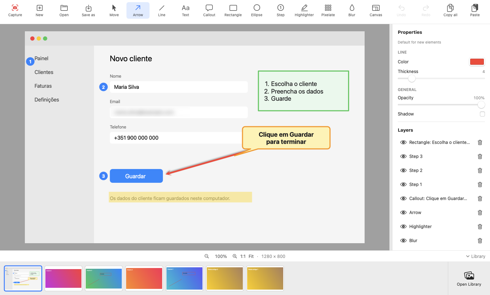

# Toth

**Captura e anota o ecrã no Mac. Tudo local: sem conta, sem nuvem, sem telemetria. Software livre (licença MIT).**
*Capture and annotate your Mac screen. Fully local: no account, no cloud, no telemetry. Free software (MIT license).*

[Português](#português) · [English](#english)

> **Versão 0.2.0 (pré-lançamento).** Descarregue em [**Releases**](../../releases/latest). Software livre, **licença MIT** ([LICENSE](LICENSE)). A app **ainda não está notarizada pela Apple** (ver *Instalação e permissões*).

---

## Português

### O que é
O **Toth** é uma app para Mac para **capturar e anotar o que está no ecrã**: escolha uma área (ou uma página inteira, rolando), acrescente setas, texto, balões, formas, etapas numeradas, marcador, pixelização e desfoque, e guarde ou copie o resultado. Tudo corre **no seu computador**: sem conta, sem nuvem, sem telemetria, sem anúncios. As anotações ficam num ficheiro `.capture` que pode voltar a editar (a imagem original nunca é alterada).

É **software livre** sob a **licença MIT**: pode usar, estudar, modificar e distribuir. Está numa versão **0.x (pré-lançamento)**: funciona, mas ainda pode ter arestas.

### Instalação e permissões (leia primeiro)
**Requisitos:** macOS 15 ou superior (Apple Silicon e Intel; testado em Apple Silicon).

**Instalar:**
1. Em [**Releases**](../../releases/latest), descarregue `Toth-0.2.0.zip` e descomprima.
2. Arraste `Toth.app` para a pasta **Aplicações**.
3. **Primeira abertura (só é preciso uma vez).** Como a app ainda não está notarizada pela Apple, o macOS mostra *“Toth” não aberto*, com os botões *Mover para o Lixo* e *OK*. **Não mova para o Lixo.** Clique em **OK**, abra **Definições do Sistema → Privacidade e Segurança**, desça até **Segurança**, clique em **Abrir mesmo assim** junto a “Toth”, confirme com a palavra-passe ou Touch ID e clique em **Abrir**. (No macOS 14 ou anterior basta botão direito → **Abrir**. Alternativa no Terminal: `xattr -dr com.apple.quarantine /Applications/Toth.app`.)
4. **Permissão (guiada).** Logo que o Toth abre, **verifica a permissão de Gravação de Ecrã** e, se faltar, mostra um guia de 3 passos: **Conceder permissão** → ativar o Toth na lista que o macOS abre → **Reiniciar o Toth** (o macOS só aplica a permissão quando a app volta a abrir). O guia fecha-se sozinho quando tudo está pronto.

**Permissões que o Toth usa:**

| Permissão | Precisa? | Para quê |
|---|---|---|
| **Gravação de Ecrã e Áudio do Sistema** | **Sim, obrigatória** | Ler os píxeis do ecrã para capturar (inclui a captura com rolagem). Só captura quando o utilizador o pede. |
| Acessibilidade | Não | O Toth **não** envia teclas nem rolagens a outras apps: quem rola é o utilizador. |
| Microfone, câmara, contactos, localização | Não | Não são usados. |
| Rede (internet) | Só para atualizações | Um único pedido à API pública do GitHub para saber se há versão nova (sem enviar dados pessoais). Pode ser desligado em *Preferências*. |

As capturas ficam na pasta `~/Pictures/Capture` e onde escolher em *Salvar como*.

**Atualizações:** o Toth procura **automaticamente** uma versão nova ao abrir (no máximo uma vez por dia) e, se houver, **pergunta** se quer atualizar: *Atualizar agora*, *Mais tarde* ou *Ignorar esta versão*. A atualização é descarregada do GitHub, **verificada** (soma SHA-256 e assinatura) e instalada sem tocar nas suas capturas; o Toth reabre sozinho. Pode desligar a procura automática ou procurar à mão em *Preferências* e no menu *Toth → Procurar atualizações…*. As versões são assinadas sempre com a mesma identidade, por isso o macOS mantém a permissão de gravação de ecrã depois de atualizar.

**Se a captura falhar ou o aviso continuar:** confirme que o Toth está ativado em *Gravação de Ecrã e Áudio do Sistema*, que o reiniciou depois de o ativar e, se for preciso, use **Repor a permissão** no guia.

**Desinstalar:** arraste `Toth.app` para o Lixo. As suas capturas em `~/Pictures/Capture` não são apagadas.

### O que faz

**Captura**
- **Região com o ecrã congelado** ao carregar no atalho: a captura é a do momento do atalho, mesmo que o ecrã mude depois. Arraste para escolher a área, **mova-a e redimensione-a** pelas alças, e só ao **confirmar** (botão *Capturar* ou **Enter**) segue para o editor. **Esc** cancela. Funciona com vários monitores.
- **Captura com rolagem:** depois de escolher a área, clique em **Rolagem** (ao lado de *Cancelar* e *Capturar*). A partir daí **role a janela como quiser**, para qualquer lado (cima, baixo, esquerda, direita), devagar ou depressa, e pode voltar atrás e passar outra vez pela mesma zona: o Toth percebe sozinho o movimento e vai juntando tudo. Só termina quando clicar em **Concluir** na barra flutuante (ou **Cancelar** para descartar). **Pausar/Retomar** deixa-o parar a captura e continuar depois, a partir de qualquer zona já capturada (o Toth guarda várias capturas recentes para voltar a alinhar). Se no fim não conseguir juntar nada, oferece **Tentar de novo**. O Toth não mexe na janela por si e não precisa de nenhuma permissão além da gravação de ecrã. Cabeçalhos e rodapés fixos aparecem uma só vez. Limites: imagens até cerca de 30 000 px de lado; role um eixo de cada vez (na diagonal não alinha); se rolar depressa demais a barra avisa e basta voltar um pouco atrás; conteúdo animado, vídeos ou páginas que carregam enquanto rola podem deixar emendas.
- **Ecrã inteiro** pelo menu da barra de menus.
- **Imagem nova**, para além das capturas: **em branco** (tamanho, cor de fundo ou transparente) ou **a partir da área de transferência** (botão *Novo*, menu *Ficheiro*; ⌘N e ⇧⌘N).
- **Atalho global configurável** (por omissão **⌃⇧4**) em *Preferências*; avisa se a combinação é do sistema ou já está em uso.

**Editor (não destrutivo: a imagem original nunca é alterada)**
- **Ferramentas:** Mover, Seta, Linha, Texto, Balão, Retângulo, Elipse, Etapa, Marcador, Pixelização, Blur e Tela.
- **Texto no próprio objeto** (texto, balão, retângulo, elipse): fonte, tamanho, negrito/itálico/sublinhado, cor, alinhamento horizontal e vertical, listas de marcadores ou numeradas.
- **Cores da linha e do preenchimento** à escolha, espessura, opacidade e sombra.
- **Etapas numeradas** (1, 2, 3 · I, II, III · i, ii, iii · A, B, C · a, b, c), com cor do círculo e do número, fonte e **reinício da sequência**. **Redimensionam-se pelos cantos mantendo a proporção** (ou pelo controlo *Tamanho*), e o número ou a letra acompanha a escala e fica sempre centrado; o último tamanho usado é lembrado.
- **Blur e Pixelização** com intensidade ajustável, para ocultar informação sensível. Atuam sobre **tudo o que está por baixo**: a imagem e também os objetos inseridos em camadas inferiores (um objeto por cima do efeito continua nítido).
- **Área de trabalho (Tela):** aumente ou diminua a imagem, com cor de fundo ou transparente; **expande-se sozinha** quando um elemento sai da área.
- **Camadas:** ordem, ocultar, remover. Qualquer elemento pode ser removido ou editado **mais tarde**, mesmo depois de fechar e reabrir.
- **Copiar, colar, duplicar**; cola **imagens e texto de outras apps**. Desfazer/refazer, zoom e deslocamento.
- **Seleção rápida:** com uma ferramenta de desenho ativa, **clicar** num objeto existente seleciona-o e mostra as opções desse objeto; **arrastar** continua a desenhar um novo (por exemplo, uma seta a partir de uma caixa). **⌥ + clique** força a criação por cima de um objeto (útil para as etapas).
- **Exportar PNG** ou **copiar tudo** para a área de transferência.

**Biblioteca**
- **Abrir Biblioteca** (botão no canto inferior direito): grelha com a **pré-visualização atual** de cada captura, para escolher clicando; faixa de miniaturas no editor, que se pode **ocultar/mostrar** (botão «Biblioteca» no rodapé, ou *Ver → Mostrar/ocultar Biblioteca*, ⌥⌘L).
- **Abrir** (barra superior): abre **qualquer imagem do computador** (PNG, JPEG, HEIC, TIFF, GIF, BMP…) no editor. Fica como captura nova (o ficheiro original não é tocado) e as alterações guardam-se; com **Salvar como** exporta em **PNG, JPEG, HEIC ou TIFF**.
- Cada captura é **um só ficheiro `.capture`** (um ZIP normal) em `~/Pictures/Capture`, com nome **sem espaços**: `Toth_AAAA-MM-DD_HH.MM.SS.capture`. Os ficheiros `.capture` **abrem com o Toth** (duplo clique, *Abrir com*, ou arrastar para o ícone do Dock).

**Comodidades**
- **Janela ajustável:** pode ficar estreita (as ferramentas deslizam na barra; as setas «‹ ›» deslizam as ferramentas **de forma contínua**: um clique avança um pouco, mantendo premido continua a deslizar, e a roda/trackpad também; apagam-se quando não há mais para esse lado), e o painel de **Propriedades** está sempre à direita, com uma divisória que se **arrasta** para o redimensionar, até desaparecer para o lado; com o painel escondido aparece uma **faixa larga** com uma pega bem visível: um clique, ou arrastar para a esquerda, volta a abri-lo (também por *Ver → Mostrar/ocultar Propriedades*, ⌥⌘P; duplo clique na divisória esconde-o).
- O Toth também aparece em *Abrir com* para imagens.
- Cada ferramenta **lembra a última personalização**, mesmo depois de fechar a app.
- **Português e inglês**, com mudança imediata em *Preferências*.
- **Privacidade:** não recolhe dados; só usa a internet para procurar atualizações (desligável).

### Usar
Carregue em **⌃⇧4** (ou use o ícone na barra de menus ou o menu *Ficheiro*) → escolha a área → **Enter** → anote → **Salvar como** / **Copiar tudo**. As **Preferências** (engrenagem no rodapé, ou ⌘,) têm o atalho e o idioma.

### Ainda não tem
Captura de janela, temporizador, cursor na captura, vídeo/áudio/GIF, apagar uma área da imagem, versão para Windows. Fora do âmbito por decisão: contas, partilha online, IA na nuvem e telemetria.

### Compilar e contribuir
Só são precisas as *Command Line Tools* do macOS (sem Xcode): `./scripts/build-app.sh` gera `dist/Toth.app` e o zip. Testes: `swift test`. Guia para programadores em [docs/DEVELOPMENT.md](docs/DEVELOPMENT.md). Contribuições são bem-vindas: abra uma *issue* ou um *pull request*. Segurança: ver [SECURITY.md](SECURITY.md).

### Licença
**Licença MIT** (software livre): [LICENSE](LICENSE) ([tradução de cortesia](LICENSE.pt.md)). © 2026 **Alex Felizardo**. O nome e o logótipo **não** estão abrangidos pela MIT (ver [TRADEMARKS.md](TRADEMARKS.md)). [Privacidade](PRIVACY.md) · [Segurança](SECURITY.md) · [Avisos de terceiros](THIRD_PARTY_NOTICES.md).

---

## English

### What it is
**Toth** is a Mac app to **capture and annotate what is on your screen**: choose an area (or a whole page, by scrolling), add arrows, text, callouts, shapes, numbered steps, highlighter, pixelate and blur, then save or copy the result. Everything runs **on your computer**: no account, no cloud, no telemetry, no ads. Annotations live in an editable `.capture` file (the original image is never changed).

It is **free software** under the **MIT License**: you may use, study, modify and distribute it. It is a **0.x (pre-release)** version: it works, but it may still have rough edges.

### Installation and permissions (read first)
**Requirements:** macOS 15 or later (Apple Silicon and Intel; tested on Apple Silicon).

**Install:**
1. Under [**Releases**](../../releases/latest), download `Toth-0.2.0.zip` and unzip it.
2. Drag `Toth.app` to the **Applications** folder.
3. **First launch (only needed once).** Because the app is not yet notarized by Apple, macOS shows *“Toth” Not Opened*, with *Move to Trash* and *Done* buttons. **Don't move it to the Trash.** Click **Done**, open **System Settings → Privacy & Security**, scroll to **Security**, click **Open Anyway** next to “Toth”, confirm with your password or Touch ID, then click **Open**. (On macOS 14 or earlier, right-click → **Open** is enough. Terminal alternative: `xattr -dr com.apple.quarantine /Applications/Toth.app`.)
4. **Permission (guided).** As soon as Toth opens it **checks the Screen Recording permission** and, if missing, shows a 3-step guide: **Grant permission** → turn Toth on in the list macOS opens → **Restart Toth** (macOS only applies the permission when the app reopens). The guide closes by itself when everything is ready.

**Permissions Toth uses:**

| Permission | Needed? | What for |
|---|---|---|
| **Screen & System Audio Recording** | **Yes, required** | Reading the screen pixels to capture (including scrolling capture). It only captures when you ask it to. |
| Accessibility | No | Toth does **not** send keys or scrolling to other apps: you do the scrolling. |
| Microphone, camera, contacts, location | No | Not used. |
| Network (internet) | Only for updates | A single request to GitHub's public API to find out whether a new version exists (no personal data sent). It can be turned off in *Preferences*. |

Captures are saved in `~/Pictures/Capture` and wherever you choose in *Save as*.

**Updates:** Toth **automatically** looks for a new version when it opens (at most once a day) and, if there is one, **asks** whether you want to update: *Update now*, *Later* or *Skip this version*. The update is downloaded from GitHub, **verified** (SHA-256 checksum and signature) and installed without touching your captures; Toth reopens by itself. You can turn automatic checking off, or check by hand, in *Preferences* and in the *Toth → Check for Updates…* menu. Releases are always signed with the same identity, so macOS keeps the screen recording permission after updating.

**If capture fails or the warning persists:** make sure Toth is on under *Screen & System Audio Recording*, that you restarted it after turning it on and, if needed, use **Reset permission** in the guide.

**Uninstall:** drag `Toth.app` to the Trash. Your captures in `~/Pictures/Capture` are not deleted.

### What it does

**Capture**
- **Region capture with a frozen screen:** the screen freezes the moment you press the shortcut, so the capture is that exact moment even if the screen changes afterwards. Drag to choose the area, **move and resize** it with the handles, and only when you **confirm** (*Capture* button or **Enter**) does it go to the editor. **Esc** cancels. Multi-monitor aware.
- **Scrolling capture:** after choosing the area, click **Scroll** (next to *Cancel* and *Capture*). From then on **scroll the window however you like**, in any direction (up, down, left, right), slowly or fast, and you can go back and pass over the same area again: Toth works out the movement by itself and keeps joining everything. It only ends when you click **Finish** on the floating bar (or **Cancel** to discard). **Pause/Resume** lets you stop capturing and carry on later from any area already captured (Toth keeps several recent captures to line up again). If it cannot join anything in the end, it offers **Try again**. Toth never touches the window by itself and needs no permission beyond screen recording. Fixed headers and footers appear only once. Limits: images up to about 30,000 px on a side; scroll one axis at a time (diagonal does not align); if you scroll too fast the bar warns you and going back a little resumes; animated content, videos or pages that load while scrolling may leave seams.
- **Full-screen capture** from the menu bar.
- **New images** besides captures: **blank** (size, background color or transparent) or **from the clipboard** (*New* button, *File* menu; ⌘N and ⇧⌘N).
- **Configurable global shortcut** (default **⌃⇧4**) in *Preferences*; it warns if a combination is taken by the system or already in use.

**Editor (non-destructive: the original image is never changed)**
- **Tools:** Move, Arrow, Line, Text, Callout, Rectangle, Ellipse, Step, Highlighter, Pixelate, Blur and Canvas.
- **Text directly in the object** (text, callout, rectangle, ellipse): font, size, bold/italic/underline, color, horizontal and vertical alignment, bulleted or numbered lists.
- Your choice of **line and fill colors**, thickness, opacity and shadow.
- **Numbered steps** (1, 2, 3 · I, II, III · i, ii, iii · A, B, C · a, b, c), with circle and number colors, font, and **sequence restart**. They **resize by their corners keeping the proportions** (or with the *Size* control), and the number or letter scales along and stays centered; the last size used is remembered.
- **Blur and Pixelate** with adjustable strength, to hide sensitive information. They act on **everything beneath them**: the image and also objects on lower layers (an object above the effect stays sharp).
- **Work area (Canvas):** enlarge or shrink the image, with a background color or transparent; it **expands automatically** when an element goes outside the area.
- **Layers:** order, hide, remove. Any element can be removed or edited **later**, even after closing and reopening.
- **Copy, paste, duplicate**; pastes **images and text from other apps**. Undo/redo, zoom and pan.
- **Quick selection:** with a drawing tool active, **clicking** an existing object selects it and shows its options; **dragging** keeps drawing a new one (for example an arrow from a box). **⌥ + click** forces creation on top of an object (handy for steps).
- **Export PNG** or **copy all** to the clipboard.

**Library**
- **Open Library** (button at the bottom right): a grid with the **current preview** of each capture to pick by clicking; a thumbnail strip in the editor.
- **Open** (top bar): opens **any image on your computer** (PNG, JPEG, HEIC, TIFF, GIF, BMP…) in the editor. It becomes a new capture (the original file is never touched) and your changes are saved; **Save as** exports **PNG, JPEG, HEIC or TIFF**.
- Each capture is **a single `.capture` file** (a standard ZIP) in `~/Pictures/Capture`, with a name **without spaces**: `Toth_YYYY-MM-DD_HH.MM.SS.capture`. `.capture` files **open with Toth** (double-click, *Open With*, or drag onto the Dock icon).

**Conveniences**
- **Adjustable window:** it can be narrow (tools slide along the bar; the «‹ ›» arrows scroll the tools **continuously**: a click nudges them, holding keeps them moving, and the wheel/trackpad works too; they dim when there is no more on that side), and the **Properties** panel is always on the right, with a divider you **drag** to resize it until it slides out of sight; when it is hidden a **wide strip** with an obvious grip appears: one click, or dragging left, brings it back (also via *View → Show/Hide Properties*, ⌥⌘P; double-clicking the divider hides it).
- Toth also appears under *Open With* for images.
- Each tool **remembers its last customization**, even after you quit the app.
- **Portuguese and English**, switchable instantly in *Preferences*.
- **Privacy:** it collects no data; it only uses the internet to check for updates (can be turned off).

### Use
Press **⌃⇧4** (or use the menu bar icon or the *File* menu) → choose the area → **Enter** → annotate → **Save as** / **Copy all**. **Preferences** (gear icon in the footer, or ⌘,) hold the shortcut and the language.

### Not yet available
Window capture, timer, cursor in captures, video/audio/GIF, erasing an area of the image, a Windows version. Out of scope by design: accounts, online sharing, cloud AI and telemetry.

### Build and contribute
Only the macOS *Command Line Tools* are needed (no Xcode): `./scripts/build-app.sh` produces `dist/Toth.app` and the zip. Tests: `swift test`. Developer guide: [docs/DEVELOPMENT.md](docs/DEVELOPMENT.md). Contributions are welcome: open an *issue* or a *pull request*. Security: see [SECURITY.md](SECURITY.md).

### License
**MIT License** (free software): [LICENSE](LICENSE). © 2026 **Alex Felizardo**. The name and the logo are **not** covered by the MIT License (see [TRADEMARKS.md](TRADEMARKS.md)). [Privacy](PRIVACY.md) · [Security](SECURITY.md) · [Third-party notices](THIRD_PARTY_NOTICES.md).
